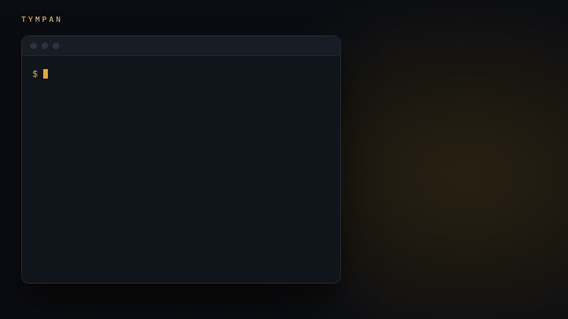
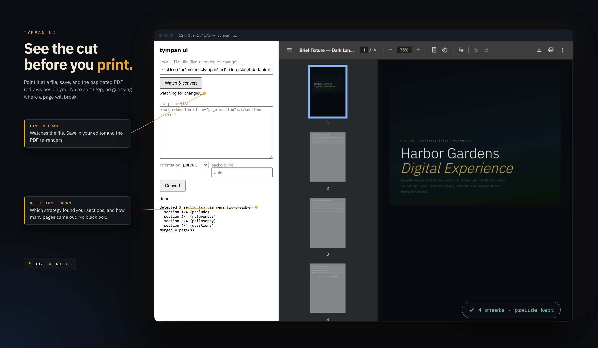
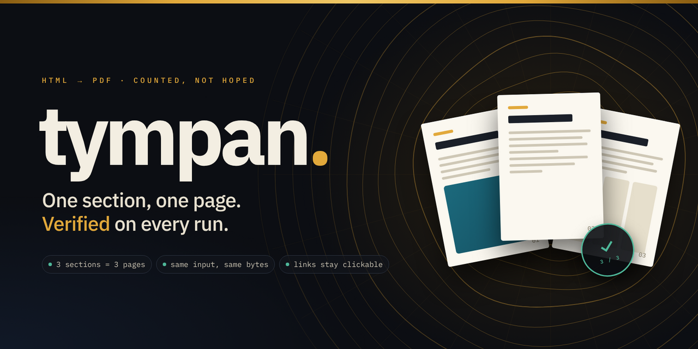

# tympan

[](https://github.com/Blvckpanda/Tympan/actions/workflows/ci.yml)
[](https://github.com/Blvckpanda/Tympan/actions/workflows/release.yml)
[](https://www.npmjs.com/package/tympan)
[](LICENSE)

**A deterministic, secure, fast HTML→PDF converter that produces verifiable
PDFs with zero configuration.** One semantic section per page — hero page
included, your page background carried over — runtime print-CSS defeated,
output self-verified. Built for the single-file HTML bundles AI assistants
produce. The charter is [SPEC.md](SPEC.md); the roadmap below is real and
staged.



Plain Playwright's `page.pdf()` prints whatever the page's print CSS says — which is
exactly what breaks AI HTML: runtime-injected `@media print` rules force page breaks
on every section, clamp covers to `100vh`, and cap pages with `@page` rules. tympan
defeats that pipeline instead of fighting it.

## Quickstart

```bash
npx tympan brief.html
# brief.pdf (A4 portrait by default) + brief-email.pdf, verified, links clickable
```

Landscape for slide decks: `npx tympan deck.html --orientation landscape`.
Force a page color: `--background "#04060a"`. Fully offline: `--offline`.

Several documents, patterns, and pipes all work:

```bash
npx tympan "invoices/*.html" -o dist/        # glob → one PDF per match, into dist/
npx tympan a.html b.html                    # a.pdf + b.pdf through one warm browser
cat brief.html | npx tympan - -o brief.pdf  # the document comes from stdin
npx tympan brief.html -o - > brief.pdf      # the PDF goes to stdout
```

Or install the `tympan` command globally:

```bash
npm install -g tympan
tympan brief.html
```

Preview it locally while you edit:

```bash
npm run ui        # or: npx -p tympan tympan-ui  (local server, live reload, PDF pane)
```

Library:

```js
import { convert } from 'tympan';
const { master, email, detection, verification, blockedRequests } = await convert('brief.html', {
  email: true,
  outline: true,
  probe: /www\.example\.city/,
});
if (!verification.ok) throw new Error('verification failed');
```

Requires Node ≥ 20 and a Chromium binary (`npx playwright install chromium`, or point
`TYMPAN_CHROMIUM` at any chrome executable).

## Why it wins

1. **Reproducible, proven:** identical input + options → **byte-identical
   PDFs** under the exact-pinned engine (fixed metadata epoch, input-derived
   `/ID`, `tympan:<hash>` keyword). Pinned by a twice-convert sha256 test —
   on fixtures and on a real 8-page document.
2. **Safe on untrusted HTML by default:** non-top-level `file://` reads are
   blocked, and private/link-local network requests are denied — including
   the cloud-metadata endpoints. Every block is counted and reported.
   Loosening is explicit: `--allow-net <host>`, or `--offline` for none.
3. **Faithful output:** portrait A4 like the document you wrote, your dark
   background (or any `--background`), the pre-section hero as page 1, the
   footer on the last page, source-width layout, selectable text, clickable
   links, bookmarks, real metadata.
4. **Diagnostics that say exactly what broke:** per-section progress,
   page-count and probe verification, blocked-request counts, non-zero exit
   codes for CI.

And the principle under all of it: **never trust a measurement.** Sections
are printed, the artifact is inspected, and the scale shrinks until the
one-page invariant *holds* — late webfonts and print rounding can't produce
sliver pages. A regression test pins this ([test/spill.test.mjs](test/spill.test.mjs)).

## Screenshots

**tympan ui** — paste HTML or watch a local file, watch sections convert one by
one (here: a dark-portrait brief — hero detected, 4 pages from 4 blocks):



The pitch as a card (also the repo's social preview — [1280×640](assets/social-card.png)):

<p align="center"></p>

## What it does

1. **Detects sections** in the rendered page: your `--selector`, then
   `section.page-section`, then `[data-page]`/`[data-slide]`, then
   `<section>`/`<article>` children of the widest main-ish container, then the whole
   document as one page.
2. **Captures the frame around the sections:** pre-section content (hero/cover)
   becomes page 1; a trailing footer band merges into the last page. Scroll
   chrome (nav bars, banners) stays out — it's not paper.
3. **Builds a clean document** per section: the page's stylesheets (including
   runtime-injected body-level ones) and the source's own page background —
   no React runtime, no injected print CSS, no `@page` caps.
4. **Prints each section onto exactly one page**, shrinking just enough when a
   section exceeds the text area — in either dimension (width is fitted too;
   nothing gets right-clipped).
5. **Merges centered** via pdf-lib — text stays selectable, **hyperlinks stay
   clickable**, and each final page is painted with the document's background
   first, margins included.
6. **Verifies** the result: page count === expected, last-page text probe,
   blocked-request tally, non-zero exit on any mismatch (CI-friendly).

## Options (CLI and library)

| Option | Default | Description |
|---|---|---|
| `selector` | auto-detect | Explicit CSS selector for sections |
| `email` | off | Also emit an image-downscaled variant (`emailMaxWidth`/`emailQuality` to tune) |
| `out` | `<input>.pdf` | Master output path |
| `probe` | none | Text (or regex source) that must appear on the last page |
| `format` | `a4` | `a4` or `letter` |
| `orientation` | `portrait` | `portrait` or `landscape` (slide decks) |
| `background` | the source's own | Page background color (CSS color) |
| `margin` | `0.4,0.5,0.4,0.5` | Page margins in inches: `N` or `T,R,B,L` (CLI) |
| `contentWidth` | the printable column | Layout width in px (`--content-width`). Can narrow the measure; cannot widen it past `(page - side margins)`, because that is what makes Chromium scale the page |
| `teaser` | none | Only convert the first N sections (CLI: `--teaser N`) |
| `flow` | off | `--flow`: skip one-sheet-per-section and let Chromium paginate the whole body once — prose that cannot fill a sheet out of a single section. Opt-in: without it, default output bytes do not move. `email` is section-mode only; `outline` works in both |
| `pageNumbers` | off | With `--flow`: `n / total` in the bottom margin, resolved by the print engine (`--page-numbers`) |
| `layout` | `deck` | `--layout deck\|flow\|auto`. `flow` is `--flow` by another name; `auto` measures every section first and picks flow only when the deck layout would waste more sheet area than `targetFill` allows or any section starts shrinking below 0.95. The result reports the pick and the arithmetic (`layoutChoice`) |
| `fill` | `balanced` | With `--flow`: `balanced` (native flow), `tight` (a BOUNDED uniform micro-scale ladder — 1, 0.98, 0.97 — keeps the fewest-pages candidate, reported in `fillPolicy`) or `loose` (keep-together also wins for `li, dd, dt`; gaps accepted). Unbounded shrink-to-fill is rejected |
| `toc` | off | `--toc`: a generated Contents page. Section mode settles the numbers by arithmetic; flow mode maps each section to the sheet its heading lands on (PDF text layer) and converges the numbering (stability reported) |
| `pageFooter` | none | With `--flow`: static running footer in the bottom margin (Blink has no string-set); `preset` book/contract resolve it from the document title |
| `preset` | none | `--preset deck\|report\|book\|invoice\|contract` — documented bundles: report = flow + page numbers; book = report + TOC + title footer + book margins; invoice = tightened side margins (section engine); contract = flow + page numbers + title footer. Explicit flags always win |
| `outline` | off | PDF bookmarks panel — one entry per section (`--outline`) |
| `title` | source `<title>` | PDF metadata title |
| `author` / `subject` / `creator` | none | PDF metadata fields |
| `offline` | off | Block every network request |
| `allowNet` | none | Hosts permitted despite the private-network blocklist (repeatable) |
| `waitFor` | none | CSS selector to wait for before printing (charts, JS-mounted content; `--wait-for`) |
| `waitTimeout` | `10000` | Timeout (ms) for `waitFor` |
| `verify` | `true` | Self-verification pass (`--no-verify` to skip) |
| `browser` | launched | Reuse an already-launched browser across conversions (batch) |
| `perInput` | none | `convertMany`: per-input option overrides (typically `out`) |
| `goldenDir` | `.tympan/golden` | `tympan test` baseline directory (`--golden`) |
| `update` | off | `tympan test`: record baselines instead of comparing (`--update`) |
| `tolerance` | `0.02` | `tympan test`: share of fingerprint cells allowed to differ |
| `diff` | off | `tympan test`: side-by-side PNG per differing page (`--diff`) |
| `diffDir` | `<golden>/diff/<input>` | `tympan test`: where those images go |
| `targetFill` | `0.7` | Share of the text area a page should carry before it is reported underfilled |
| `strict` | off | `tympan lint`: treat warnings as failures (`--strict`) |
| `port` | `4319` | `tympan preview`: port to listen on (0 picks a free one) |
| `concurrency` | `2` | `tympan serve`: jobs in flight (`--concurrency`, env `TYMPAN_SERVE_CONCURRENCY`) |

Diagnostics: `tympan doctor` checks the environment (Node version, exact
playwright pin vs installed, Chromium, ffmpeg) and exits non-zero on failure;
`tympan deck.html --json` prints a stable machine-readable report on stdout
(progress stays on stderr) for CI to consume.

## Two layout engines: `deck` and `flow`

Deck layout — one semantic section per sheet, shrunk only when it must be — is
the default and the right answer for slide-shaped documents. Prose pays for
that rigidity: a 400px section cannot fill a 1,045px sheet, so pages run
half-empty no matter how the spacing is tuned.

`--flow` is the other engine: one clean document, Chromium's own fragmentation
doing the pagination (headings keep with their text, tables and figures stay
whole, orphans/widows 2). Pages fill because content flows, not because type
shrank — scale stays 1 by construction.

```bash
tympan brief.html --flow --page-numbers --toc --outline
```

The verification a flowing print can prove is different from a deck's, so it
asserts a different set: pages were produced, none blank, nothing clipped at
the page edge, nothing wider than the column, probe still matching. One thing
Chromium never reports — which sheet a `break-inside: avoid` block landed on —
is reported as UNMEASURED, never as verified clean.

Presets pick a bundle so nobody memorises flags:

```bash
tympan thesis.html --preset book      # flow + numbers + Contents + running title
tympan terms.html  --preset contract  # flow + numbers + running title, no TOC
```

Explicit flags win over any preset, both on the CLI and over the HTTP API.

## Batch, stdin, globs

Several inputs convert through **one warm browser** — one Chromium launch for
however many documents you hand over, sequentially (printing is CPU-bound; order
and output bytes stay deterministic).

```bash
tympan "invoices/*.html" -o dist/      # quoted glob → one PDF per match, into dist/
tympan a.html b.html                   # a.pdf + b.pdf beside their sources
cat brief.html | tympan - -o brief.pdf # stdin; relative refs resolve in the cwd
tympan brief.html -o - > brief.pdf     # stdout; nothing written behind your back
```

Rules: `-o` names a file for one input, and a **directory** when there are several
inputs or the path ends in a separator (created if it does not exist yet); `-`
streams to stdout (one input, no `--json`). A pattern that matches nothing is an
error, never a silent skip. A document that fails does not abandon the rest of
the batch: every input is reported, and the exit code is non-zero if any failed.

## Visual regression: `tympan test`

Text extraction cannot see a dropped background, a collapsed grid, or a figure
that stopped rendering. `tympan test` converts each input, fingerprints every
rendered page into a small RGB grid, and compares it with a recorded baseline:

```bash
tympan test "reports/*.html" --update      # record baselines, review the PNGs, commit them
tympan test "reports/*.html"               # exit 1 on any visual change
tympan test report.html -o review/         # keep the generated PDFs while you diff
tympan test report.html --tolerance 0.05   # allow 5% of cells to differ
tympan test report.html --diff             # + a side-by-side image per changed page
```

Baselines live in `.tympan/golden/<input>-<hash>/pNNN.png` — one viewable PNG per
page, so reviewing a diff is `open` on the file the report names. A shrinking
document fails (`stale baseline`), and a geometry change (format/orientation) is
reported as such instead of being squashed to fit. Rasterization uses pdfjs
(already a dependency) inside Chromium: no new package, no server, no port.

With `--diff`, every differing page also gets a side-by-side image under
`.tympan/golden/diff/<input>-<hash>/pNNN.png`:

```
[ baseline ]  [ current ]  [ current, differing cells marked red ]
```

The panels are the comparison's own grid — one visible block is one compared
cell — magnified with nearest-neighbour scaling rather than redrawn, so nothing
is hidden by smoothing. The report also says *where* the change is ("change is
12-38% down the sheet"), which separates a whole-page reflow from one moved
block. Review images are a convenience: if composing one fails, the comparison
result stands and the run does not fail because of it.

## Diagnostics: `tympan lint`

A converter that produces the wrong-looking PDF in silence is worse than one
that fails. `tympan lint` converts with the same flags and explains what the
measurements already know — naming the page, not averaging the document:

```bash
tympan lint brief.html                 # findings + a fill line, exit 0 unless an error
tympan lint brief.html --strict        # warnings become failures (CI gate)
tympan lint deck.html --target-fill 0  # a deliberately sparse full-bleed deck: no fill findings
tympan lint "docs/*.html" --json       # machine-readable findings
tympan lint brief.html --a11y          # + the accessibility rules on the source (below)
```

```
[warn] brief.html
     fill: mean 64%, min 17%; 6 page(s) under 70%; 2 page(s) shrunk to fit
     warning page-underfilled: page 5 is 33% full — 698px of blank sheet below the content
     warning page-scaled: page 6 was scaled to 89% to fit — its section is taller than the text area, so its type renders smaller than a page that fit
     note    content-width-clamped: the document lays out at 774px; it prints at a 698px column so nothing is scaled (type stays its authored size) — print to a wider sheet or reduce side margins for a wider measure
```

The rules, and why each one exists:

| Rule | Severity | What it means |
|---|---|---|
| `broken-asset` | error | An image that did not load and prints as blank space |
| `conversion-failed` | error | The document could not be converted at all |
| `no-pages` | error | Nothing was produced |
| `page-underfilled` | warning | A page carrying little of its text area |
| `stranded-heading` | warning | A page ending on a heading, so its content is overleaf |
| `split-keep-together` | warning | A table row or figure split across pages |
| `page-scaled` | warning | A section too tall for the sheet, shrunk to fit (type smaller than its neighbours) |
| `content-overflow` | warning | A page whose own content is wider than the text column |
| `column-narrower-than-layout` | warning | An invariant check: the layout is wider than the printed column, so **every** page would be silently scaled. Geometry resolution caps the layout at the column, so this only fires for a caller that assembles its own geometry |
| `content-width-clamped` | note | The document asked for a wider measure than the paper has, so it was laid out at the column instead. Named because it changes the author's design on purpose |
| `blocked-request` | warning | A request the security gate refused, with the reason |
| `fixed-position`, `viewport-clamp` | warning | Blocks that print once, or are taller than the sheet |
| `inconsistent-scale` | warning | Pages disagree on type size by more than 5% |
| `print-css-in-source` | note | The document carries its own print CSS. `@media print` and `@page` rules are stripped at the CSSOM before printing, so they cannot fragment the page (proved by a fixture that used to spill) |

**`--a11y` — the accessibility rules** (SPEC §4's Phase 2 lint half, on the
source, opt-in because they add a second body walk):

| Rule | Severity | What it means |
|---|---|---|
| `a11y-html-lang` | warning | No lang on `<html>` — screen readers cannot pick a voice (WCAG 3.1.1) |
| `a11y-img-alt` | warning | Images with no alt attribute at all (`alt=""` is fine for decorative — missing is not) |
| `a11y-form-label` | warning | Form controls with no label, aria-label or title (WCAG 4.1.2) |
| `a11y-contrast` | warning | Text under the WCAG 1.4.3 floor (4.5:1, or 3:1 for large type), measured with alpha compositing over the nearest opaque ancestor background |
| `a11y-heading-order` | note | A heading outline with a hole (h1 then h3) |
| `a11y-heading-count` | note | Zero or several h1 elements |
| `a11y-no-headings` | note | No headings at all — PDF navigation rides on them |
| `a11y-generic-link` | note | Link text that names nothing ("click here") with no aria-label instead |
| `a11y-table-headers` | note | Data tables with no header row |

Two design choices worth stating. **Errors are things that are wrong** (a lost
image, no output); a sparse page is a *finding*, because covers, statement bands
and full-bleed figures are meant to be sparse — `--strict` is how a caller
promotes warnings. And **lint never rasterizes**: every finding is a DOM
measurement or a computed geometry value, so it is cheap, deterministic, and
immune to the trap that a painted background makes any coverage metric read as
100% full.

## Size: `tympan bytes`

A conversion that weighs 400 KB deserves to say why — and a size-reduction
claim deserves a baseline (SPEC §4 makes "measured size reduction vs baseline"
Phase 2's exit criterion; optimization before measurement is guessing).
`tympan bytes` converts with the same flags and audits the PRODUCED PDF, so
the same document in two modes is directly comparable:

```bash
tympan bytes brief.html          # where the bytes are, in one report
tympan bytes deck.html --flow    # compare: the same deck printed once
tympan bytes "docs/*.html"       # one report per input, one warm browser
tympan bytes brief.html --json   # machine-readable (every object listed)
```

```
[bytes] article-medium.html — 80.2 KB, 3 pages (section mode)
     font        66.0 KB (82%)  4 object(s); largest #13 29.0 KB
     content      4.0 KB ( 5%)  25 object(s); largest #15 0.9 KB
     structure    6.7 KB ( 8%)  27 object(s)  (xref, dicts, trailer)
tympan bytes: 1 document(s), 80.2 KB total
```

Buckets: **images**, **fonts** (embedded programs — per-section glyph subsets
can reach a high share on prose; printing once with `--flow` is the fix that
v0.8 measured at 3.2x), **content** (the paint list), **forms** (pattern and
shading resources), **metadata**, **other**, and **structure** (xref,
dictionaries, trailer — every scanned byte ties out). It never decompresses:
sizes are the bytes each object occupies on disk, which is exactly what an
optimization shrinks. It names the share and the largest objects — it does not
judge; a photo deck spending 90% on images is a photo deck. On PDF 1.5
files the plumbing itself — the cross-reference stream and object streams
(`--minify`'s output) — buckets as **other**, so a rewritten file never
reads as "more content".

## Smaller file: `--minify`

Measurement pointed at one honest lever: Chromium's output is already flate
where it is big (fonts, images), so the pass rewrites the FILE, never the
document - dictionaries pack into compressed object streams, the xref
becomes one compressed `/Type /XRef` stream, unfiltered streams gain
`/FlateDecode`, and everything else is copied byte for byte with its
original object number. Object numbers, pages, painted content and
extractable text are all preserved; encrypted and incrementally-updated
PDFs are refused loudly. Deterministic by construction: the same input
always yields the same bytes.

Measured on the prose corpus (`tympan bytes` before/after; article-medium,
section mode): 82,148 -> 76,461 bytes, a 7% cut on a document where 82%
of the weight is font programs the pass does not touch - the plumbing it
does touch is most of what remains. Pair the flag with `tympan bytes` so
the claim stays a measurement:

```bash
tympan article.html --minify -o out.pdf    # same document, smaller file
tympan bytes article.html --flow --minify  # audit the rewritten bytes
tympan 'docs/*.html' --minify -o dist/     # whole corpus, one warm browser
```

## Live preview: `tympan preview`

Printing is the only way to be *certain* about a page break — the printer closes
its loop by counting the pages Chromium actually produced. Everything else about
a sheet is known earlier, from the DOM, and that is what `tympan preview` shows:
one paper-sized sheet per detected section, carrying the section's own
rendering, the text area drawn to scale, the shrink factor, and how much of the
sheet the content will occupy.

```bash
tympan preview brief.html              # http://127.0.0.1:4321
tympan preview brief.html --port 0     # any free port
tympan preview deck.html --orientation landscape --margin 0.5
```

Every sheet is drawn at its real size (A4 portrait is 794×1122px at 96dpi) with:

- the section rendered at the print column width, scaled by the factor the
  printer will apply — so type that will shrink looks shrunk;
- a dashed box for the **usable text area** (the sheet minus margins), so the
  blank tail is not an abstraction;
- a solid red line where **the content will stop**, which is the fill line;
- corner tags for the page number, its section, `fill 15% · scale 90%`, and an
  amber badge when the sheet **ends on a heading**;
- the same findings `tympan lint` would print, in the sidebar.

Save the file and the page re-measures (polling, not `fs.watch` — reliable
across editors); *Re-measure* forces it, *Overlay on/off* hides the guides when
you just want to look at the design. The measurement reuses the printer's own
clean template, waits and `measureBlockInPage`, so the numbers are the
converter's numbers by construction — and the test suite pins that: for every
page, the preview's fill must agree with the converted PDF's fill within 5%.

Two things to know. It binds to **127.0.0.1 only**, serves nothing but its own
page and the sheet images it just rendered, and needs no network. And the shrink
it shows is the printer's *initial estimate*: the printer still confirms by
printing and counting pages, which a preview cannot do.

## Benchmark: `scripts/corpus.mjs`

No body of prose is worth a percentage. The corpus is 52 documents across 13
archetypes (article, report, invoice, résumé, deck, wide-table ledger, form,
quote, newsletter, RTL, CJK, dark theme, viewport-sized hero) generated
*deterministically* by `scripts/corpus/generate.mjs` — so a published number can
be tied to the corpus that produced it — and measured end to end:

```bash
node scripts/corpus.mjs                       # measure, print, write docs/
node scripts/corpus.mjs --limit 8             # a quick run while iterating
node scripts/corpus.mjs --compare docs/benchmarks.json   # drift since a release
```

The committed results ([docs/BENCHMARKS.md](docs/BENCHMARKS.md) for humans,
[docs/benchmarks.json](docs/benchmarks.json) for CI) carry page count, mean and
minimum fill, output size, render time and lint findings per document — and the
engine pin, the corpus hash and the platform, because a number without its
engine is not a measurement. A test asserts the committed hash matches the
generator: change the corpus without re-running and the suite fails before a
stale number reaches a README.

The report also states what it cannot say: the corpus is generated, not
scraped; fill is a DOM measurement (pixel coverage reads 100% on a full-bleed
sheet, which is exactly how a four-page document once looked clean); and render
time is one machine, warm browser, sequential — comparable across releases, not
a throughput claim.

## Hosted: `tympan serve`

An HTTP API in front of the same converter, with per-tenant API keys, a bounded
job queue, a worker pool, TTL retention and a Dockerfile pinned to the engine
version. A remote caller sends `html` or a `url` — **never a server path** — and
the network policy is the server's, so a client cannot ask for `allowNet` or
`offline`. A key never sees another tenant's job.

```bash
TYMPAN_KEYS="key_live_abc:acme" tympan serve --port 8080
docker build -t tympan . && docker run --rm -p 8080:8080 -e TYMPAN_KEYS=... tympan
```

It is a **spike with production-shaped seams**, and [docs/SERVE.md](docs/SERVE.md)
says exactly which parts are which: the key store is an environment variable,
the queue is memory (a restart loses queued work), results are a temp directory,
and there is no metering or billing — followed by what a paid tier would need
before charging anyone.

## How is this different from Playwright / Gotenberg / WeasyPrint?

| | Rendering engine | AI-HTML pagination | One section per page | Self-verifying |
|---|---|---|---|---|
| Playwright / Puppeteer | Chromium | whatever the page's print CSS dictates — often broken | no | no |
| Gotenberg | Chromium (Docker API) | same as Playwright | no | no |
| WeasyPrint / Dompdf | no JS — cannot render AI bundles at all | — | — | — |
| **tympan** | Chromium (via Playwright, exact-pinned) | **defeats runtime print CSS by cloning each section into a clean document** | **guaranteed, with auto-shrink in both dimensions** | **built in, exit codes for CI** |

tympan is an opinionated *layer* on Chromium, not a new engine: the value is the
pipeline, not the renderer.

## Roadmap

The staged plan lives in [SPEC.md](SPEC.md) (phases §4, adoption decisions §10).
Where things stand:

- **Now (v0.5):** the reliable core — portrait default, background-faithful
  pages, hero capture, closed-loop shrink-to-fit (regression-tested),
  byte-identical output, secure-by-default request gating with
  `--offline`/`--allow-net` escapes, links + outline + metadata, email
  variant, preview UI, self-verification with CI exit codes, tag-driven
  releases with provenance and **zero npm tokens**.
- **Now (v0.8):** `--flow` (one print, Chromium paginates, pages fill),
  `--layout auto` (measure, then choose), `--toc`, real outline destinations
  in flow mode, `--page-footer`, `--fill balanced|tight|loose`, presets
  (`deck|report|book|invoice|contract`), local sibling images inlined as data
  URIs, and fill baselines inside `tympan test`.
- **Diagnostics and preview (shipped early, see SPEC §10):** `tympan lint`
  (the spec's Phase 1 diagnostics list: failed requests, overflow warnings,
  `--strict`, JSON) and `tympan preview` (Phase 1 sketch: live page-break and
  fill overlay). **Phase 2 — standards:** tagged PDF/PDF-UA, PDF/A, size
  optimization, accessibility `lint`.

Non-goals (from the spec): our own layout engine, a GUI, a general PDF
editor, Word/PowerPoint conversion, OCR, AI in the render path.

## Limitations (honest ones)

- Content that lives **only** in print media CSS won't appear: the whole point is
  printing the screen composition with the app's runtime print CSS stripped out.
- Gradient page backgrounds are carried into the template but the
  margins-painting pass applies the solid base color — a gradient sheet keeps
  its gradient inside the content column only.
- One section = one page is a hard rule in DECK mode (the default): an overfull
  section shrinks to fit rather than flowing onto a second page. `--flow` is
  the engine for everything else.
- **Local images and stylesheets are gated, not inlined — with one exception.**
  The security gate blocks every `file://` request except the document itself.
  Sibling IMAGES are now handled properly: Node reads the file and inlines it
  as a data URI before printing (extension- and size-capped), so `src="logo.png"
  prints for real and nothing is unblocked. Stylesheets stay refused; a
  missing asset stays a `broken-asset` error.
- **The layout is capped at the printed column, not widened to fit the design.**
  A document authored at 774px prints at A4's 698px column (0.5in side margins),
  so nothing is scaled and type keeps its authored size — but the measure is
  narrower than the author wrote, and reflow can make a section taller. Type is
  never silently shrunk for width; a section taller than the sheet still shrinks
  to fit (that is the one-section-per-page rule below, and `--flow` is its fix).
- Determinism holds under the exact-pinned engine (`playwright` is
  version-locked); a Chromium update is a rendering change and bumps bytes.

## Contributing & releasing

PRs welcome — see [CONTRIBUTING.md](CONTRIBUTING.md) for setup and the test gates.
Releases are cut by version tags; the process lives in
[PUBLISHING.md](PUBLISHING.md). The social preview card is
[assets/social-card.png](assets/social-card.png) (1280×640).

## Status

v0.7.0 completes the spec's Phase 1 input story — **file, URL, stdin, glob**, and
batch conversion through one warm browser — and adds `tympan test` for visual
regression in CI. Earlier releases: portrait + fidelity, proven determinism,
secure defaults, `--wait-for`/`doctor`/`--json` diagnostics, clickable links
preserved through the merge, PDF outline + metadata, the local preview UI, and
tag-driven release automation with provenance. See
[CHANGELOG](CHANGELOG.md) for history.

## License

[MIT](LICENSE)
